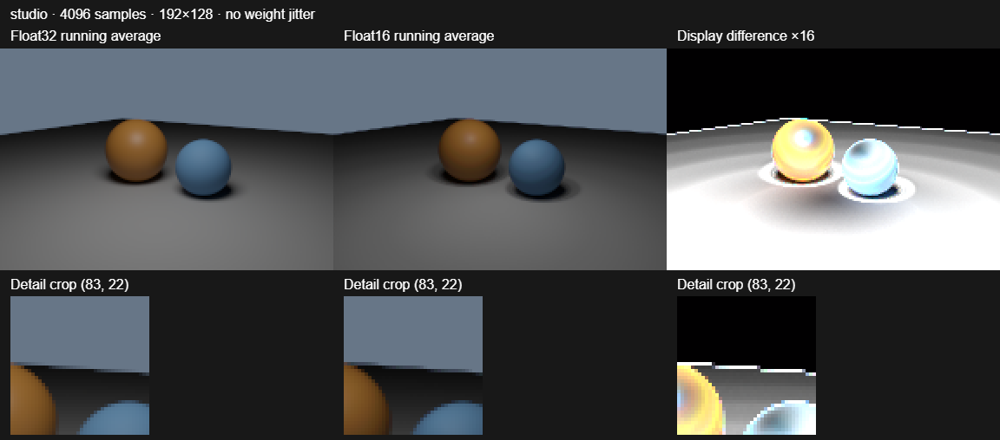
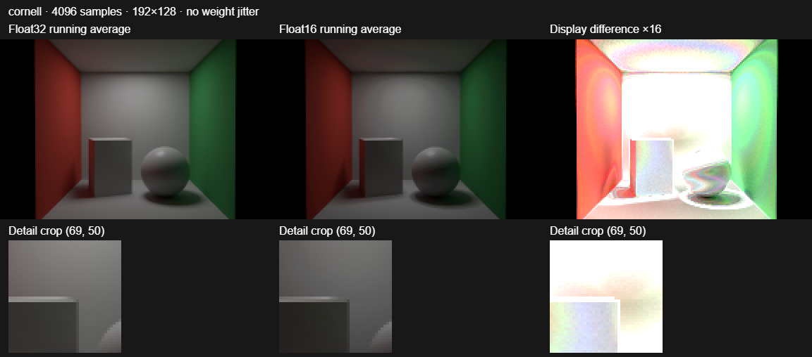
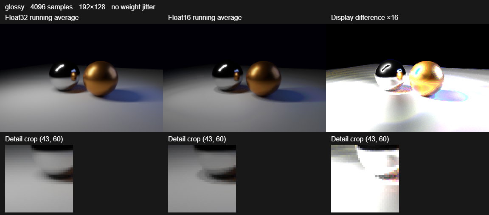
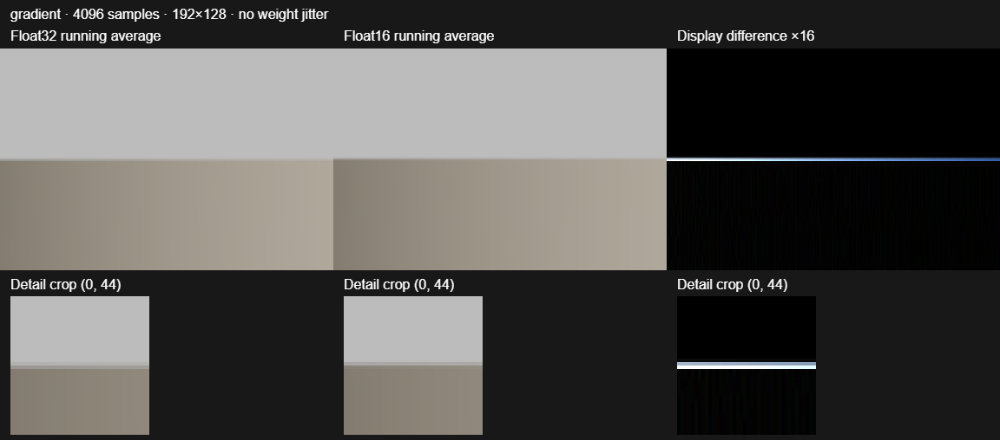

# Float16 versus float32 running-average accumulation

Weight jitter has been removed. Both modes use the existing ordinary `1 / sampleCount` running average. `halfFloatAccumulation = true` changes only color storage to RGBA16F; the default remains RGBA32F. Camera-ray jitter and the original sampling strategy remain unchanged.

**Result on this GPU:** float16 saves memory, but its image error grows as samples accumulate. It is not a reliable replacement for converged float32 rendering with the current averaging implementation. Measured throughput changes range from 0.21% to 0.78%; see the individual trials below before treating small differences as a speedup.

## Accuracy

Physical NVIDIA GTX 1050 (Pascal), Windows/Chrome WebGPU, megakernel backend, 192×128, four bounces, no denoiser. Both precisions receive identical ray samples. Initial backend allocation occurs before resetting the seed; an additional float32 render at 256 samples matches the first render bit-for-bit in all four scenes. Earlier jitter experiments are superseded by these measurements.

Normalized RGB RMSE is `sqrt(sum((half-full)^2) / sum(full^2))`, computed from raw linear RGB before tone mapping. Each column compares against **float32 at the same sample count**, isolating accumulation precision from Monte Carlo noise. It is not mean per-pixel relative error or error against noise-free ground truth. The bias column is `sum(half-full) / sum(full)` across RGB channels at 4096 samples.

| Scene | 64 samples | 256 samples | 1024 samples | 4096 samples | Mean radiance bias at 4096 |
| --- | ---: | ---: | ---: | ---: | ---: |
| studio | 0.69% | 2.69% | 10.24% | 22.18% | -17.43% |
| cornell | 1.17% | 4.50% | 16.00% | 39.15% | -39.08% |
| glossy | 1.18% | 4.41% | 14.90% | 44.85% | -37.12% |
| gradient | 0.17% | 0.49% | 1.53% | 2.19% | -0.38% |

The raw [accuracy measurements](precision-comparison/quality.json) also include linear RMSE, display-space RMSE, 99th-percentile and maximum absolute errors, nonfinite counts, and comparison to the final float32 reference. No nonfinite values occurred in these scenes. No test approaches half's 65,504 maximum; HDR overflow remains an additional limitation outside this tested range.

### Where the images fail

- **Studio:** diffuse surfaces and soft shading darken with increasing samples. The constant background remains much closer, making the bias on objects apparent.
- **Cornell box:** indirect illumination and color bleeding are suppressed. At 4096 samples the mean RGB energy is approximately 39% below float32, so more samples do not recover the correct brightness.
- **Glossy:** reflected highlights and rough reflections lose energy. Large HDR absolute differences occur in highlights; tone mapping compresses them but does not remove the broader darkening.
- **Emissive gradient:** the overall image looks closer, but the smooth ramp acquires visible quantization structure under magnification and the sharp brightness boundary develops a precision-dependent error. The difference image reveals detail hidden in the full-size view.

A running average avoids storing an ever-growing sum, but it still rounds the stored image after every sample. The corrective update becomes smaller as `n` increases; updates below a half-float quantization step can be lost. This implementation shows accumulated negative bias as well as quantized updates. It should not be described merely as a sample counter overflowing. Snapshot channels unchanged between 1024 and 4096 are recorded as an exploratory diagnostic, not proof they remained frozen throughout that interval. Results depend on hardware, compiler and the averaging expression; these are measurements of the existing expression on Pascal, not a claim that every possible float16 averaging algorithm behaves identically.

## Throughput

Physical NVIDIA GTX 1050, 768×512, four bounces, no denoising or dynamic resolution. The real path tracer, accumulation writes/copies and canvas presentation pass are included. Vsync and frame caps are disabled in Chrome. Each precision warms up for at least one second, then runs sequentially for **at least five seconds**, in float32/float16/float16/float32 (ABBA) order. Sixteen render updates are submitted per batch, and the GPU queue is drained before the completed batch counts and before switching modes. No individual frames are timed.

Rates are completed **sample-equivalent image frames per second**: the change in average samples per pixel divided by total elapsed time. In wavefront rendering, pixels finish at different times, so this is not a count of full-image synchronous frames. Wavefront counts come from GPU tally/readback; megakernel counts are derived from completed dispatches after queue completion. The reported rate pools the two trials per precision. Compare precisions within a backend; update counts alone are not quality-equivalent between backends.

| Scene | Backend | Float32 sample-frames/s | Float16 sample-frames/s | Float16 change |
| --- | --- | ---: | ---: | ---: |
| studio | mega | 21.83 | 21.93 | 0.44% |
| studio | wavefront | 29.79 | 29.92 | 0.44% |
| cornell | mega | 9.69 | 9.71 | 0.21% |
| cornell | wavefront | 17.74 | 17.82 | 0.45% |
| glossy | mega | 20.43 | 20.49 | 0.33% |
| glossy | wavefront | 29.71 | 29.87 | 0.56% |
| gradient | mega | 37.03 | 37.31 | 0.78% |
| gradient | wavefront | 30.12 | 30.33 | 0.69% |

All elapsed times, GPU-completed counts and per-trial rates are in [throughput.json](precision-comparison/throughput.json). Two trials per precision on one GPU are a limited sample, not a statistical significance test; small changes can be scheduling, clock or measurement variation. This benchmark does not establish performance on other GPUs or scene sizes.

## Images

Each panel shows float32, float16 and the absolute **display-space difference amplified 16×**, followed by the same detail crop for each. All images use the same Reinhard exposure and sRGB transfer within a scene. Image data is 192×128, enlarged with nearest-neighbor sampling for inspection. Metrics above use uncompressed linear values, not PNG pixels. Crop selection uses the largest display-space error and includes its coordinates. Images show 4096 samples.

### studio



[Float32](precision-comparison/studio-float32.png) · [Float16](precision-comparison/studio-float16.png) · [Difference ×16](precision-comparison/studio-difference.png)

### cornell



[Float32](precision-comparison/cornell-float32.png) · [Float16](precision-comparison/cornell-float16.png) · [Difference ×16](precision-comparison/cornell-difference.png)

### glossy



[Float32](precision-comparison/glossy-float32.png) · [Float16](precision-comparison/glossy-float16.png) · [Difference ×16](precision-comparison/glossy-difference.png)

### gradient



[Float32](precision-comparison/gradient-float32.png) · [Float16](precision-comparison/gradient-float16.png) · [Difference ×16](precision-comparison/gradient-difference.png)

## Memory and recommendation

Texture count is unchanged. Color storage halves. WebGPU's two color buffers plus separate R32Uint sample counter shrink from **36 to 20 bytes/pixel (44.4%)**: 71.19 to 39.55 MiB at 1080p, or 284.77 to 158.20 MiB at 4K. These are format-based allocation sizes, not total-process VRAM measurements; scene, ray, depth, preview and denoiser storage are separate.

Keep float32 as the default and use it for converged renders. The half option may fit low-sample, memory-constrained previews if their error is acceptable, but accumulating more samples does not make these half images approach float32. The tested low-sample differences are much smaller than the high-sample failures. Alternative averaging formulations, compensated storage or stochastic rounding would need separate evaluation; none are silently introduced here.

## Reproduce and validation

```powershell
npm ci
npm run test:accumulation
npm run lint
npm run build
$env:CHROME_PATH = 'C:/Program Files/Google/Chrome/Application/chrome.exe'
node scripts/test-accumulation.js <output-directory>
node scripts/summarize-precision.js <output-directory>
```

Use `--quality-only`, `--benchmark-only` or `--smoke-only` to run stages separately; optional `PRECISION_SCENES` is a comma-separated subset. The full run covers both backend format/reset/resize/alpha/preview smoke tests, then all quality and throughput scenes. The summary command expects every scene's files. Chrome must expose a physical GPU; software adapters and fallback contexts are rejected. The runner owns and closes its server/browser. File watching is disabled so edits cannot navigate away from a running measurement. Generated root `build/` outputs must not be committed.

Build, lint/typecheck (18 existing warnings), added-script lint, and metric unit tests passed. Both WebGPU backends have hardware precision-toggle/resize/reset/coverage/preview smoke coverage. Detailed multi-scene accuracy images are megakernel measurements, and throughput covers both WebGPU backends. WebGL uses the same restored original weighting but these new accuracy/speed tables do not claim WebGL results. The legacy branch-switching screenshot-diff workflow was not run.

The PR targets `accumulation-research-base`, the upstream snapshot at 6096de4ffcd. The existing fork main was 1654 commits behind; main was left unchanged.
